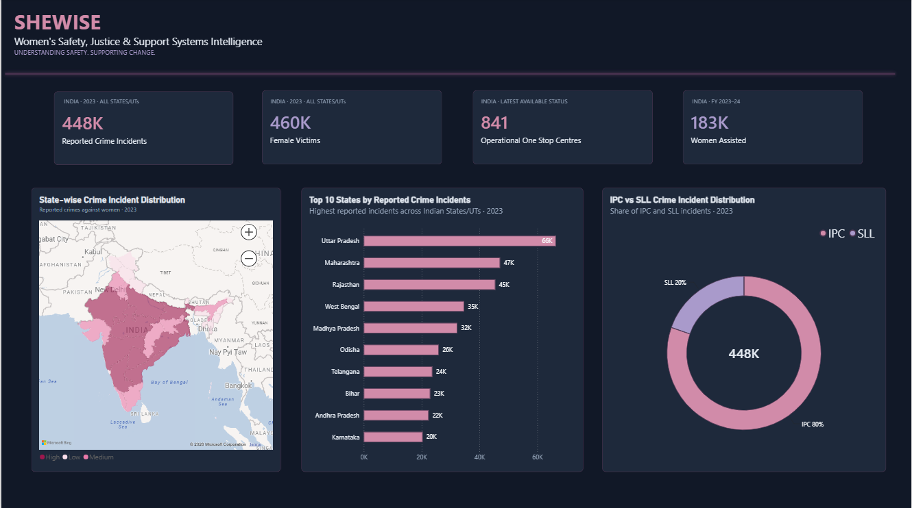
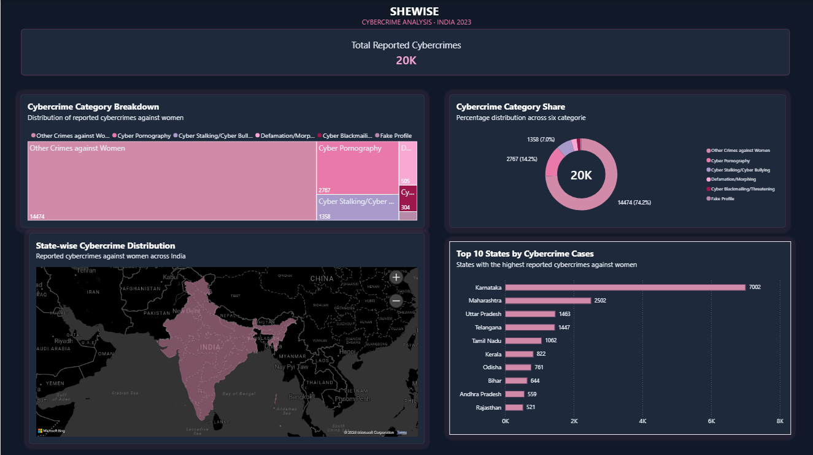
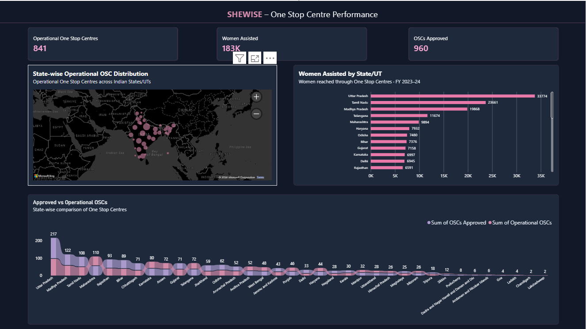

# SHEWISE – Women's Safety & Support Systems Intelligence

## Project Overview
SHEWISE is an interactive Power BI dashboard designed to analyse women's safety, cybercrime trends, and the performance of support systems across India.

The project brings together reported crime statistics and One Stop Centre (OSC) data to provide a consolidated view of important indicators and help users explore state-wise patterns.

## Dashboard Pages

### 1. National Overview
- Reported crime incidents and female victims.
- State-wise crime distribution across India.
- Top 10 States/UTs by reported crime incidents.
- IPC vs SLL crime comparison.

### 2. Cybercrime Analysis
- Total reported cybercrimes against women.
- Cybercrime category breakdown.
- State-wise cybercrime distribution.
- Top 10 States/UTs by cybercrime cases.

### 3. One Stop Centre Performance
- Operational and approved One Stop Centres.
- Women assisted during FY 2023–24.
- State-wise operational OSC distribution.
- Comparison of approved and operational centres.

## Tools & Technologies
- Microsoft Power BI
- Power Query
- Data Cleaning and Transformation
- Data Visualization and Exploratory Data Analysis

## Key Features
- Interactive dashboard pages.
- State-wise analysis.
- KPI-based performance monitoring.
- Crime category comparisons.
- Visual exploration of women's support infrastructure.

## Data Sources
The dashboard uses the source datasets selected for reported crimes against women, cybercrimes against women, and One Stop Centre statistics in India.

Refer to the original data publications and source files for definitions, reporting periods and coverage.

## Important Note
Reported crime figures represent registered/reported cases and should not be interpreted as the complete prevalence of crime. One Stop Centre statistics describe reported service delivery and infrastructure, not necessarily the quality or accessibility of services.

## Project Objective
To transform public data into meaningful visual insights that support awareness, exploration and evidence-informed discussions about women's safety and support systems in India.

---

**Project:** SHEWISE  
**Category:** Data Analytics & Business Intelligence  
**Developed using:** Microsoft Power BI

## Dashboard Preview

### Page 1 – National Overview

### Page 2 – Cybercrime Analysis

### Page 3 – One Stop Centre Performance

